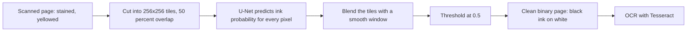
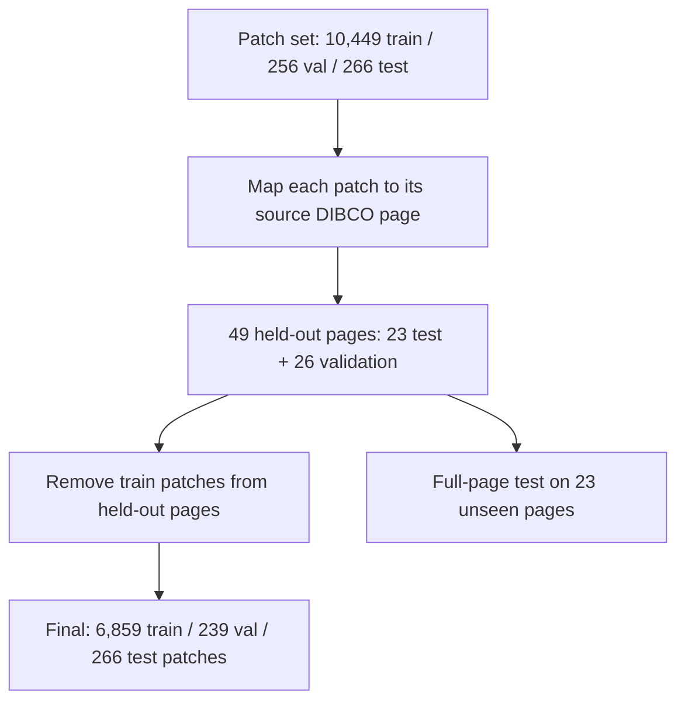
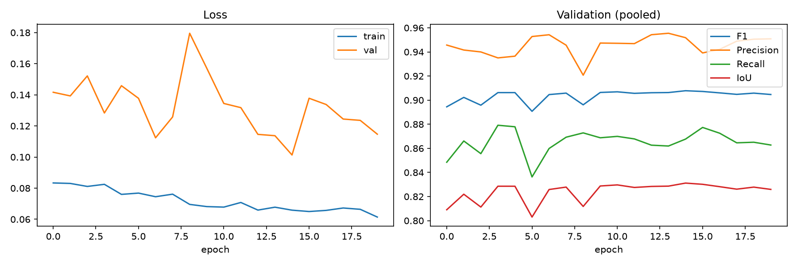
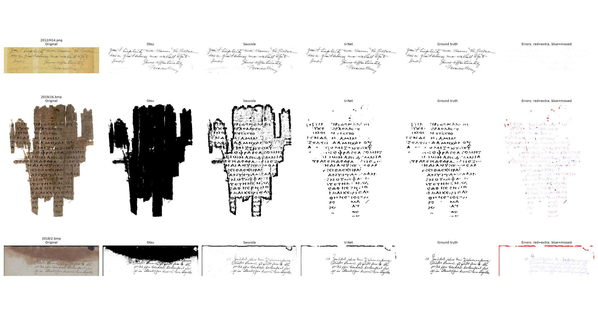

# Manuscript Image Processing

### Deep-learning cleaning and binarization of historical manuscripts, ready for OCR


Old manuscripts are stained, yellowed and soaked through with ink from the other side of the page. This project trains a **U-Net**
that looks at a scanned page and decides, for every pixel, *"is this ink or just damage?"*. The output is a **clean black-and-white page**
that is easier to read, print, archive and feed to OCR software.

It comes with a complete experiment (leak-free data splits, training, evaluation against classic methods, OCR test) and a
**web app, Manuscript Cleaner**, where anyone can upload a stained page and get the cleaned result.

> **Headline result:** on 23 full pages the model never saw, the U-Net reaches a mean F1 of **0.888**
> (95% CI 0.850 to 0.924), against 0.682 for the Sauvola local filter and 0.571 for Otsu's global threshold.
> It beat Sauvola on **all 23 pages**, and cut the typical OCR character error rate by more than a quarter (0.460 to 0.334).

---

## Table of contents
1. [What problem does this solve?](#what-problem-does-this-solve)
2. [How it works](#how-it-works)
3. [Model](#model)
4. [Data and how leakage was prevented](#data-and-how-leakage-was-prevented)
5. [Training setup](#training-setup)
6. [Results](#results)
7. [Where the model still fails](#where-the-model-still-fails)
8. [Web app: Manuscript Cleaner](#web-app-manuscript-cleaner)
9. [Reproduce the experiment](#reproduce-the-experiment)
10. [Repository structure](#repository-structure)
11. [Limitations and future work](#limitations-and-future-work)
12. [References and acknowledgements](#references-and-acknowledgements)

---

## What problem does this solve?

| Damage | What it looks like | Why it hurts |
|---|---|---|
| **Stains** (water, mould, coffee) | dark blotches | to a computer a dark patch looks just like ink |
| **Yellowing** | brown paper | less contrast between paper and writing |
| **Ink bleed-through** | writing from the back shows through | ghost strokes that are not part of the page |

**Binarization** turns the page into pure black ink on white paper. Classic methods use a brightness threshold:
Otsu picks one threshold for the whole page, Sauvola picks one per neighbourhood. Both are fooled by stains.
A neural network can look at the *shape* of strokes and learn to separate handwriting from damage.

---

## How it works



1. **Tiling.** A page is cut into overlapping 256 x 256 tiles (stride 128), so pages of any size fit in GPU memory.
2. **Prediction.** The U-Net outputs an ink probability for each pixel of every tile.
3. **Blending.** Overlapping predictions are averaged with a smooth (Hann) window, so there are no visible seams.
4. **Thresholding.** Probabilities above 0.5 become ink. The result is a binary page.
5. **OCR (optional).** Tesseract reads the cleaned page. Cleaner input gives fewer reading mistakes.

---

## Model

A standard **U-Net** (encoder, decoder and skip connections) written in PyTorch.

| Item | Value |
|---|---|
| Input / output | RGB tile 256 x 256 / one-channel ink logit map |
| Encoder | 4 down-sampling stages: 32, 64, 128, 256 channels, 512 at the bottleneck (conv + BatchNorm + ReLU, twice per stage) |
| Decoder | 4 up-sampling stages (transposed convolution) with skip connections |
| Parameters | about 7.8 million (checkpoint about 31 MB) |
| Loss | 0.5 x BCE + 0.5 x Dice (ink is only 5 to 8 percent of pixels, so Dice matters) |
| Optimizer | Adam, lr 1e-3, halved when validation F1 stalls (`ReduceLROnPlateau`) |
| Precision | mixed precision (AMP) on CUDA |

**Augmentation** (applied on the fly): flips and 90-degree rotations, brightness/contrast changes, paper yellowing,
synthetic water-stain blobs, Gaussian noise and blur. Patches with text are sampled far more often than blank ones.

---

## Data and how leakage was prevented

Data come from the **DIBCO / H-DIBCO** document-binarization benchmarks (contest years 2009 to 2019, without 2015).
Every page comes with an expert's hand-traced binary answer.

| Source | Content | Role |
|---|---|---|
| Official DIBCO pages | 136 full pages (10, 10, 16, 14, 16, 10, 10, 20, 10, 20 per year) | defines the held-out pages and the full-page test |
| Pre-cut patch set | 10,449 train / 256 val / 266 test patches (384 x 384 train, 256 x 256 val and test) with binary ground truth | training, validation and patch-level test |

### The leakage problem, and the fix

A large share of the patch set turned out to be **crops of the same DIBCO pages used for testing**.
A template-matching check (ground-truth crop vs. full pages) found that roughly 57 to 86 percent of the sampled
non-blank patches in each split are exact crops of DIBCO pages, and that some training patches came from pages that also fed
validation and test. Training on those and then testing on the full pages would have inflated every score.

The fix:

1. Every validation and test patch was mapped back to its source page. This gave **49 held-out pages**: **23 test pages** and **26 validation pages**.
2. Every training patch that came from a held-out page was removed: **3,589 of 10,448** training patches, plus 17 validation patches that came from test pages.
3. A sanity check on 800 remaining training patches found **0** that still matched a held-out page.



Final splits: **6,859 train / 239 validation / 266 test patches**, and **23 full test pages**
(all ten pages of DIBCO 2018 plus pages from 2009, 2010, 2012, 2014, 2017 and 2019), so the test is partly a test on an unseen contest year.

---

## Training setup

| Item | Value |
|---|---|
| Hardware | NVIDIA GeForce RTX 5050 Laptop GPU (8 GB), PyTorch 2.14.1 + CUDA 13.0 |
| Epochs | 20 x 4,000 random patches per epoch, batch size 8 |
| Early stopping | patience 6, **not triggered**: all 20 epochs ran. Best checkpoint at **epoch 15** (validation F1 **0.9078**) |
| Learning rate | 1e-3, halved to 5e-4 at epoch 8 and to 2.5e-4 at epoch 19 (`ReduceLROnPlateau`) |
| Speed | about 85 seconds per epoch (epochs took longer when the laptop throttled) |

> **Note on the reported checkpoint.** The final 20-epoch session **resumed from the weights of an earlier training session**
> (its first-epoch training loss was already 0.083, far below the 0.27 of a fresh start). The curves therefore show fine-tuning,
> not learning from scratch. Validation F1 was already about 0.89 at the start and stayed between 0.89 and 0.91.

<p align="center">
  
</p>

---

## Results

All numbers come from one final training run. Test pages and patches were never used for training or for choosing the checkpoint.

### Full-page test (23 unseen pages)

| Method | F1 (mean, sd) | Precision | Recall | IoU | Pixel accuracy | PSNR |
|---|---|---|---|---|---|---|
| **U-Net (this project)** | **0.888** (0.094) | 0.893 | 0.895 | 0.810 | 0.985 | 20.2 dB |
| Sauvola (local threshold) | 0.682 (0.195) | 0.674 | 0.785 | 0.548 | 0.949 | 14.5 dB |
| Otsu (global threshold) | 0.571 (0.281) | 0.496 | 0.880 | 0.453 | 0.833 | 11.6 dB |

* **95% bootstrap CI** for the U-Net F1: **0.850 to 0.924**. U-Net minus Sauvola: **+0.206** (95% CI 0.148 to 0.267).
* The U-Net beat Sauvola on **23 of 23 pages** and Otsu on **22 of 23**.
* Training randomness matters: different training runs scored **0.854, 0.878 and 0.888** on these same 23 pages, so differences of a few hundredths of F1 between runs are within noise.

| Contest year | Pages | U-Net F1 |
|---|---|---|
| 2009, 2010 | 1 + 1 | 0.930, 0.971 |
| 2012, 2014 | 2 + 1 | 0.973, 0.980 |
| 2017 | 4 | 0.938 |
| 2018 | 10 | 0.863 |
| 2019 | 4 | 0.805 |

Newer contests (2018, 2019) are harder: more bleed-through, scan borders and faded ink.

### Patch-level test (266 patches, pooled over all pixels)

| Method | F1 | Precision | Recall | IoU |
|---|---|---|---|---|
| **U-Net** | **0.882** | 0.885 | 0.879 | 0.789 |
| Sauvola | 0.629 | 0.540 | 0.754 | 0.459 |
| Otsu | 0.318 | 0.194 | 0.891 | 0.189 |

### Does it fix "ink inflation"?

Predicted ink divided by true ink equals recall divided by precision:

| Method | Predicted ink / true ink (patches) |
|---|---|
| Otsu | about **4.6 x** (stains become ink) |
| Sauvola | about 1.4 x |
| **U-Net** | about **1.0 x** |

The classic filters turn stains into ink. The U-Net does not.

### Why F1 and not accuracy?

Only 5 to 8 percent of a page is ink. A model that finds no ink at all would still score about 92 to 95 percent pixel accuracy,
and Sauvola reaches 95 percent. Accuracy cannot tell a good binarizer from a useless one, so **F1 is the main metric**.

### Downstream OCR (Tesseract)

OCR reference text is the OCR of the ground-truth image. 14 held-out pages had enough text to measure.
Lower is better.

| | Original scan | Sauvola | **U-Net cleaned** |
|---|---|---|---|
| **Median** character error rate (CER) | 0.460 | 0.614 | **0.334** |
| **Median** word error rate (WER) | 0.934 | 1.042 | **0.846** |

* The U-Net improved CER on **8 of 14** pages and WER on **10 of 14**. Sauvola binarization made OCR *worse* than the raw scan.
* By type (mean CER, original to U-Net): printed 0.219 to **0.107** (5 pages), handwritten 0.742 to **0.396** (2 pages), mixed 1.598 to **1.209** (7 pages).
* **Caveat:** the sample is small, the five printed pages are validation pages, and Tesseract is built for print, so handwriting stays hard.
  On already-clean pages binarization can hurt (for example `2017/17`, where the raw scan already reads almost perfectly).
* **The OCR numbers are noisy.** An earlier run with a *lower* F1 (0.854) gave a median CER of 0.232, against 0.334 now, so treat the size of the OCR gain as approximate. The direction was the same in every run: cleaned pages read better than the raw scans, and Sauvola does not.

### Visual results (best, median and worst test page: `2012/H14`, `2017/17`, `2018/2`)

<p align="center">
  
</p>

Columns: original, Otsu, Sauvola, U-Net, expert ground truth, and an error map (red = extra ink, blue = missed ink).

---

## Where the model still fails

* **Large dark stains and scan borders** at the edge of a page can be read as ink. The worst test page (`2018/2`) has a dark band along the top that the model partly keeps (the red area in its error map), although Otsu and Sauvola do far worse there.
* **Very faint ink** can be missed (blue pixels), which lowers recall on faded pages such as `2017/17`.
* **Strong bleed-through** can leave ghost strokes.
* **Handwriting OCR** remains weak, even on a clean page.

---

## Web app: Manuscript Cleaner

A plain-language website with a backend that runs the trained model.

* Explains the problem, the method and the results in simple words.
* **Try it:** upload, drag-and-drop or paste a page, or pick a sample page.
* Before/after slider, tabs to compare the AI result with the simple and local filters, how much of the page each method marks as ink, download of the cleaned page.
* Optional OCR panel that compares text read from the original and from the cleaned page.
* Uploads are processed in memory and never stored. The backend is FastAPI; the front end is plain HTML, CSS and JavaScript.

```bash
cd manuscript_app
pip install -r requirements.txt                    # PyTorch is assumed to be installed already
python tools/make_samples.py --outputs ../outputs_v2 --count 6   # optional sample pages from held-out test pages
python tools/check_model.py                        # one-minute GPU self-test
python -m uvicorn app.main:app --host 127.0.0.1 --port 8000      # then open http://127.0.0.1:8000
```

The app looks for the weights in `manuscript_app/models/`, in `../outputs_v2/best_unet_v2.pth`, or at the path in `MODEL_PATH`.
Hosting notes (Hugging Face, Docker, Vercel for the static pages) are in [`manuscript_app/DEPLOY.md`](manuscript_app/DEPLOY.md).

---

## Reproduce the experiment

The whole experiment lives in [`ManuScript.ipynb`](ManuScript.ipynb).

**Environment:** Python 3.11, PyTorch with CUDA, OpenCV, scikit-image, pandas, scikit-learn, matplotlib, tqdm, rapidfuzz, pytesseract
(and the Tesseract program for the OCR step).

```bash
pip install opencv-python-headless scikit-image tqdm pandas matplotlib scikit-learn rapidfuzz pytesseract ipywidgets
```

**Data (not included in the repository):** place the DIBCO pages and the patch set under a `data` folder and set `DATA` and `OUT_DIR`
in the configuration cell:

```
data/
├── raw/<year>/...        official DIBCO pages: input and ground-truth folders per year
└── Restomer_data/        train, train_gt, valid, valid_gt, test, test_gt  (pre-cut patches)
```

**Notebook layout**

| Part | What it does | Time (RTX 5050) |
|---|---|---|
| Part 1: data preparation | pairs images with ground truth, checks for leakage, maps patches to pages, builds the final splits, saves `outputs_v2/final_*.csv` | about 30 min |
| Part 2: training and evaluation | trains the U-Net, evaluates on patches and full pages, bootstrap confidence intervals, error maps, OCR | about 25 min training |

Part 2 only needs the saved splits, so after one run of Part 1 you can skip it.
Set `RETRAIN = False` to reuse the saved model (`outputs_v2/best_unet_v2.pth`) instead of training again.
Training continues from the weights currently in memory, so **run the model cell (T3) right before the training cell** to start from freshly initialised weights.
Training is not bit-for-bit repeatable on a GPU, so expect small differences between runs.

---

## Repository structure

```
.
├── ManuScript.ipynb          full experiment: data preparation, training, evaluation, OCR
├── outputs_v2/               model checkpoint, training history, split files, result tables and figures
│   ├── best_unet_v2.pth      trained model (about 31 MB)
│   ├── final_*.csv           train / val / test patch lists and held-out pages
│   ├── test_pages_per_page_v2.csv, test_patch_results_v2.csv, ocr_results_v2.csv
│   └── training_curves_v2.png, compare_best_median_worst_v2.png
└── manuscript_app/           web app (backend + website)
    ├── app/                  FastAPI backend, U-Net loading, tiling
    ├── static/               website (HTML, CSS, JS, results data, samples)
    ├── tools/                sample builder and GPU self-test
    └── DEPLOY.md             hosting guide
```

---

## Limitations and future work

**Limitations**
* The benchmark is small: 23 test pages (10 from a single contest year), so the confidence interval is about plus or minus 0.04.
* Different pages of the same manuscript can appear in training and test, so a "different page" is not always a different writer or document.
* OCR evidence rests on 14 pages, and the printed pages come from the validation set.
* Scores are computed with this project's own metric code, not the official DIBCO evaluation tool, so they are not directly comparable to contest rankings.

**Ideas for improvement**
* Simulate bleed-through and dark scan borders during training.
* Cross-validation by whole pages, and a larger, more varied test set.
* Attention U-Net or transformer-based models; test-time augmentation.
* Run the model in the browser (ONNX Runtime Web) so the site needs no backend.
* A handwriting-aware OCR engine for the downstream step.

---

## References and acknowledgements

* O. Ronneberger, P. Fischer, T. Brox. *U-Net: Convolutional Networks for Biomedical Image Segmentation.* MICCAI 2015.
* N. Otsu. *A threshold selection method from gray-level histograms.* IEEE Trans. Systems, Man, and Cybernetics, 1979.
* J. Sauvola, M. Pietikainen. *Adaptive document image binarization.* Pattern Recognition, 2000.
* The ICDAR / ICFHR **DIBCO and H-DIBCO** document image binarization contests (2009 to 2019), whose benchmark pages and expert ground truth made this work possible.
* Tesseract OCR, PyTorch, FastAPI, OpenCV and scikit-image.

## License and data terms

This project is shared for educational and research purposes. The DIBCO images and their ground truth belong to their original authors and are
subject to their terms; they are not redistributed here (except small sample crops used by the demo, if you generate them).

## Author

**Satish Kumar Prajapati** · GitHub: [@satish-kumar07](https://github.com/satish-kumar07)
